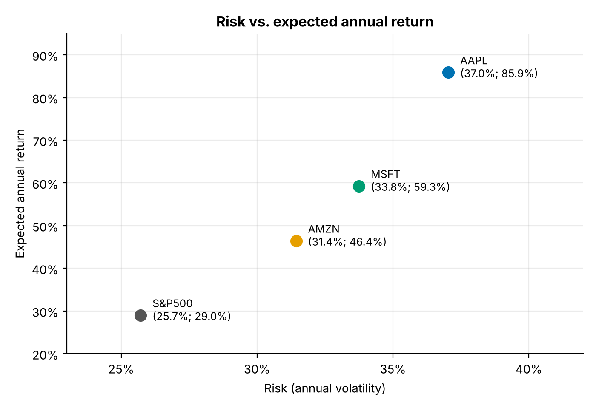
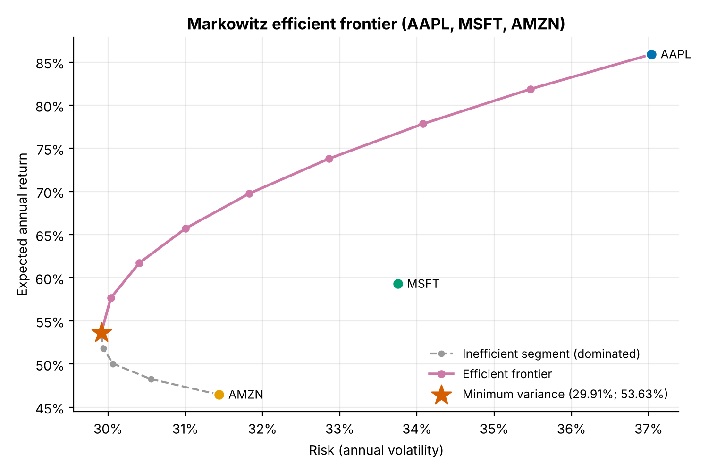
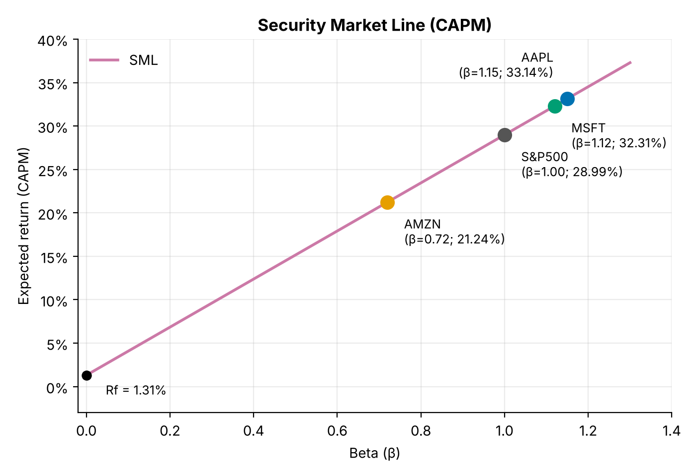

# Portfolio Optimisation with Markowitz and CAPM

**Case study:** *Manuela's new responsibilities and her investment decision in the capital markets*


An investment analysis of **Apple (AAPL)**, **Microsoft (MSFT)** and **Amazon (AMZN)** against the **S&P 500**: historical risk and return, the minimum-variance portfolio and the Markowitz efficient frontier, the CAPM and Security Market Line, the Capital Market Line, and a 10-year wealth projection. The model is solved in Excel (with Solver) and replicated in Python, which also checks every figure against the workbook.

---

## Executive summary

Manuela has to decide how to invest a family capital of **USD 2,000,000** over a **10-year** horizon. The analysis uses 505 daily closing prices from Yahoo Finance (3 September 2019 to 1 September 2021), which give 504 daily arithmetic returns, annualised with 252 trading days.

| Result | Value |
|---|---|
| Highest historical annual return | AAPL, **85.90%** (volatility 37.04%) |
| Lowest volatility among the stocks | AMZN, **31.44%** (return 46.44%) |
| Minimum-variance portfolio | **7.70%** AAPL, **32.27%** MSFT, **60.03%** AMZN |
| Its risk and return | volatility **29.91%**, return **53.63%** |
| Market Sharpe ratio (slope of the CML) | **1.0762** |
| 50% S&P 500 + 50% risk-free portfolio | return **15.15%**, volatility **12.86%** |
| Future value of USD 2,000,000 after 10 years with that portfolio | **USD 8,196,024.31** |

## Conclusions for Manuela's decision

1. **Diversification reduces risk.** The minimum-variance portfolio (29.91%) is less volatile than any of the three stocks on its own, including AMZN (31.44%), and it also returns more than AMZN (53.63% against 46.44%). Holding only AMZN is dominated by that mix.
2. **The efficient frontier runs from the vertex to AAPL.** Between the vertex (29.91%; 53.63%) and 100% AAPL (37.04%; 85.90%), every point offers the highest possible return for its level of risk. MSFT on its own lies below the frontier.
3. **More return requires more risk.** Moving from the vertex to 100% AAPL adds about 7 percentage points of volatility in exchange for about 32 points of historical return. Which point to choose is a matter of Manuela's risk tolerance, not of finding "the best portfolio".
4. **The CAPM is far more conservative than history.** With each stock's beta, the required return is between 21% and 33%, and the historical return exceeds it by 25 to 53 percentage points. These gaps reflect an exceptionally favourable period for these stocks, not a return that should be expected to last.
5. **The lowest-risk option is the mixed one.** Combining 50% S&P 500 with 50% risk-free asset gives a volatility of 12.86%, less than half that of any individual stock, with a return of 15.15%.
6. **The 10-year projection is very sensitive to the return assumption.** The USD 8.2 million (4.1 times the capital) comes from applying for a decade the return of a market that rose 28.99% a year over this two-year window. It should be read as an optimistic scenario rather than a forecast (see [Limitations](#limitations)).

> This repository is an academic quantitative-analysis project. It is not financial advice.

---

## Data and assumptions

| Parameter | Value |
|---|---|
| Assets | AAPL, MSFT, AMZN and the S&P 500 (market portfolio) |
| Price source | Yahoo Finance, daily closing prices |
| Period | 3/9/2019 to 1/9/2021 (505 prices, 504 returns) |
| Annualisation | 252 trading days per year |
| Risk-free rate $R_f$ | 1.31% (10-year Treasury, 1/9/2021, U.S. Department of the Treasury) |
| Betas $\beta$ | AAPL 1.15 · MSFT 1.12 · AMZN 0.72 · S&P 500 1.00 |
| Initial capital / horizon | USD 2,000,000 / 10 years |
| Optimisation constraints | $\sum w_i = 1$ and $w_i \ge 0$ (no short selling) |

The workbook's betas match, rounded to two decimals, the sample betas $\mathrm{Cov}(R_i,R_m)/\mathrm{Var}(R_m)$ computed from the same 504 returns.

---

## Methodology and results

### Phase A. Individual risk and return

**Daily arithmetic return:**

$$R_t = \frac{P_t}{P_{t-1}} - 1$$

**Expected annual return** (the daily arithmetic mean, compounded) and **annual volatility** (the daily sample standard deviation, scaled):

$$E(R_{annual}) = \left(1 + \overline{R}_{daily}\right)^{252} - 1 \qquad\qquad \sigma_{annual} = \sigma_{daily} \sqrt{252}$$

| Asset | Mean daily return | Daily volatility | **Annual return** | **Annual volatility** |
|---|---:|---:|---:|---:|
| AAPL | 0.2464% | 2.3331% | **85.90%** | **37.04%** |
| MSFT | 0.1849% | 2.1261% | **59.29%** | **33.75%** |
| AMZN | 0.1515% | 1.9805% | **46.44%** | **31.44%** |
| S&P 500 | 0.1011% | 1.6200% | **28.99%** | **25.72%** |



### Phase B. Modern portfolio theory (Markowitz)

**Annualised variance-covariance matrix** (daily sample covariance × 252):

$$\Sigma = 252 \cdot \mathrm{Cov}_{daily}$$

| | AAPL | MSFT | AMZN |
|---|---:|---:|---:|
| **AAPL** | 0.1372 | 0.1005 | 0.0774 |
| **MSFT** | 0.1005 | 0.1139 | 0.0749 |
| **AMZN** | 0.0774 | 0.0749 | 0.0988 |

**Portfolio return and risk** for a weight vector $w$ (column vector):

$$E(R_p) = \sum_{i} w_i E(R_i) \qquad\qquad \sigma_p = \sqrt{w^{\top} \Sigma w}$$

In Excel: `=RAIZ(MMULT(MMULT(weights; cov_matrix); TRANSPONER(weights)))` (`SQRT`, `MMULT`, `TRANSPOSE` in English Excel).

**Minimum-variance portfolio** (Solver in Excel, `scipy.optimize` in Python):

$$\min_{w} \sigma_p = \sqrt{w^{\top} \Sigma w} \quad \text{s.t.} \quad \sum_i w_i = 1 \quad \text{and} \quad w_i \ge 0$$

| | AAPL | MSFT | AMZN | Return | Volatility |
|---|---:|---:|---:|---:|---:|
| **Minimum variance** | 7.70% | 32.27% | 60.03% | **53.63%** | **29.91%** |

**13-point efficient frontier.** For each target return $\mu^*$, risk is minimised with the extra constraint $w^{\top}E(R) = \mu^*$. The targets run from the return of 100% AMZN to that of 100% AAPL, passing through the vertex (4 equal steps up to the vertex and 8 from it).

| Point | AAPL | MSFT | AMZN | Return | Volatility | Efficient? |
|---:|---:|---:|---:|---:|---:|:---:|
| 1 | 0.00% | 0.00% | 100.00% | 46.44% | 31.44% | No |
| 2 | 0.00% | 13.98% | 86.02% | 48.24% | 30.56% | No |
| 3 | 0.00% | 27.96% | 72.04% | 50.04% | 30.06% | No |
| 4 | 2.40% | 34.56% | 63.04% | 51.83% | 29.94% | No |
| **5 (vertex)** | **7.70%** | **32.27%** | **60.03%** | **53.63%** | **29.91%** | **Yes** |
| 6 | 19.60% | 27.13% | 53.27% | 57.66% | 30.04% | Yes |
| 7 | 31.50% | 21.98% | 46.52% | 61.70% | 30.40% | Yes |
| 8 | 43.40% | 16.84% | 39.76% | 65.73% | 31.01% | Yes |
| 9 | 55.29% | 11.70% | 33.01% | 69.77% | 31.83% | Yes |
| 10 | 67.19% | 6.55% | 26.25% | 73.80% | 32.86% | Yes |
| 11 | 79.09% | 1.41% | 19.50% | 77.83% | 34.08% | Yes |
| 12 | 89.78% | 0.00% | 10.22% | 81.87% | 35.47% | Yes |
| 13 | 100.00% | 0.00% | 0.00% | 85.90% | 37.04% | Yes |

Points 1 to 4 lie below the vertex: for each of them there is a portfolio with less risk and more return (the vertex). That is why the Python chart draws them as an inefficient segment, whereas the Excel chart joins all 13 points in a single curve.



### Phase C. CAPM and the Security Market Line

$$E(R_i) = R_f + \beta_i \big(E(R_m) - R_f\big)$$

with $R_f = 0.0131$ (1.31%) and $E(R_m) = 0.2899$ (28.99%, the S&P 500's historical annual return).

| Asset | Beta | **CAPM return** | Historical return | Historical − CAPM |
|---|---:|---:|---:|---:|
| AAPL | 1.15 | **33.14%** | 85.90% | +52.77 pp |
| MSFT | 1.12 | **32.31%** | 59.29% | +26.98 pp |
| AMZN | 0.72 | **21.24%** | 46.44% | +25.21 pp |
| S&P 500 | 1.00 | **28.99%** | 28.99% | 0.00 pp |



### Phase D. Capital Market Line, 50/50 allocation and projection

**Market Sharpe ratio** (slope of the CML):

$$SR_m = \frac{R_m - R_f}{\sigma_m} = \frac{0.2899 - 0.0131}{0.2572} = \mathbf{1.0762}$$

**Mixed portfolio** (50% S&P 500 and 50% risk-free asset). Its return is the weighted average and its risk is solved from the CML:

$$E(R_p) = 0.5 \times 0.0131 + 0.5 \times 0.2899 = \mathbf{0.1515} \qquad\qquad \sigma_p = \frac{E(R_p) - R_f}{SR_m} = \mathbf{0.1286}$$

That is, a return of **15.15%** and a volatility of **12.86%**. Because the risk-free asset has zero volatility, the same risk follows from $\sigma_p = 0.5 \times \sigma_m = 0.5 \times 0.2572 = 0.1286$.

**Future value of the wealth:**

$$FV = C_0 (1 + E(R_p))^{t} = 2{,}000{,}000 \times (1.15148)^{10} = \mathbf{8{,}196{,}024.31}$$

That is, a future value of **USD 8,196,024.31**.

---

## Repository structure

```
.
├── README.md
├── LICENSE
├── requirements.txt
├── excel/
│   └── Datos-Caso-Final.xlsx        # solved workbook (source of the data and results)
├── src/
│   └── portfolio_analysis.py        # replicates every Excel calculation in Python
├── data/                            # results exported by the script (CSV)
│   ├── asset_results.csv
│   ├── annual_covariance_matrix.csv
│   ├── min_variance_portfolio.csv
│   ├── efficient_frontier.csv
│   ├── capm.csv
│   ├── cml_projection.csv
│   └── excel_vs_python_verification.csv
├── images/                          # the 3 charts generated by the script
└── docs/
    └── excel_guide.md               # cell-by-cell map of the Excel workbook
```

## Excel workbook guide

The workbook `excel/Datos-Caso-Final.xlsx` has a single sheet, `Hoja1`. Its labels are in Spanish (for example, *Rendimientos Aritmeticos*, *Retorno Anual*, *Volatilidad Anual*). These are the main areas (the cell-by-cell detail is in [`docs/excel_guide.md`](docs/excel_guide.md)):

| Area | Content |
|---|---|
| `A1:E506` | Daily closing prices (most recent first). The Apple header reads "APPL". |
| `M3:P506` | 504 daily arithmetic returns |
| `T2:W6` | Daily and annual return and volatility |
| `Z2:AB7` and `AD2:AH6` | Pairwise covariances and the annualised variance-covariance matrix |
| `AE10:AG10` | Portfolio weights (Solver's changing cells) |
| `AF14`, `AF15`, `AF16` | Portfolio return, risk (matrix formula) and sum of weights |
| `AK2:AL15` | 13-point efficient frontier (return and risk) |
| `G3:K7` | Betas, risk-free rate and CAPM returns |
| `G26:H34` | Market Sharpe ratio, 50/50 portfolio and wealth projection |

Three scatter charts in the sheet: risk vs. return (`T5:W6`), efficient frontier (`AK3:AL15`) and SML (`H3:K3` against `H7:K7`).

**If you re-run Solver:** set it to minimise `AF15`, changing `AE10:AG10`, with `AF16 = 1` and the option "Make unconstrained variables non-negative". Cells `AG14` and `AG15` hold the vertex's return and risk as pasted values, and `AK7` and `AL7` depend on them. If you change the weights, update those two cells by hand. The same applies to the frontier risks in `AL3:AL15`, which are pasted results.

## Running the Python script

Tested with Python 3.13, numpy 2.5, pandas 3.0, scipy 1.18, matplotlib 3.11 and openpyxl 3.1. The minimum versions in `requirements.txt` are indicative and have not been tested.

```bash
git clone https://github.com/Jesusgonzmar/markowitz-capm-portfolio-analysis.git
cd markowitz-capm-portfolio-analysis

python -m venv .venv
source .venv/bin/activate          # on Windows: .venv\Scripts\activate
pip install -r requirements.txt

python src/portfolio_analysis.py
```

The script reads prices and parameters (risk-free rate, betas, capital, horizon and CML weights) directly from the Excel workbook, prints the results to the console, writes the CSV files to `data/` and the three charts to `images/`. Options: `--excel PATH` to use a different workbook, `--show` to display the charts on screen.

## Verification

When it finishes, the script compares 63 values with the cells Excel had already calculated (returns, volatilities, covariance matrix, weights, CAPM, Sharpe ratio, 50/50 portfolio, future value and the 13 frontier points). The maximum absolute difference is **4 × 10⁻⁷**, due to the optimisers' tolerance. The detail is in [`data/excel_vs_python_verification.csv`](data/excel_vs_python_verification.csv).

## Limitations

- **A short and exceptional window.** Two years (September 2019 to September 2021) include the 2020 crash and rebound. An average return of 28.99% a year for the S&P 500 and 85.90% for AAPL are not returns to expect in the long run. A historical average is not a forecast.
- **The projection inherits that bias.** The future value of USD 8.2 million assumes holding a 15.15% return for 10 years, which depends directly on the market's return in that window. With a lower market return, the result would fall sharply.
- **CAPM and SML.** With the workbook's data, the CAPM required return sits well below the historical return of all three stocks. The model is single-factor and uses a risk-free rate observed on a single date.
- **Annualisation.** The annual return compounds the daily arithmetic mean, while volatility scales with $\sqrt{252}$. This is the case-study convention, but it is not the compounded return actually earned.
- **No practical constraints.** Transaction costs, taxes and rebalancing are ignored, and short selling is not allowed.
- **Optimal weights are unstable.** They depend on means and covariances estimated from 504 observations.

## References

- Markowitz, H. (1952). Portfolio selection. *The Journal of Finance*, 7(1), 77–91.
- Sharpe, W. F. (1964). Capital asset prices: a theory of market equilibrium under conditions of risk. *The Journal of Finance*, 19(3), 425–442.
- Lintner, J. (1965). The valuation of risk assets and the selection of risky investments in stock portfolios and capital budgets. *The Review of Economics and Statistics*, 47(1), 13–37.

## Licence

Distributed under the [MIT licence](LICENSE).
